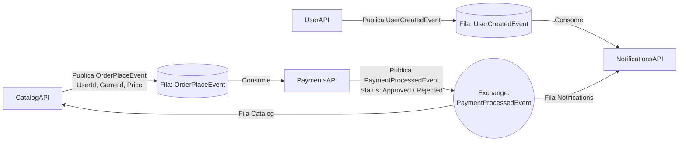

# GameStore - Infraestrutura & Orquestração (`gamestore-infra`)

Repositório central de infraestrutura e orquestração da plataforma **GameStore** (.NET 10), responsável por provisionar e integrar toda a **Arquitetura de Microsserviços Orientada a Eventos (Event-Driven Architecture)** via **Docker Compose** e **Kubernetes**, utilizando **RabbitMQ (MassTransit)** como Message Broker.

---

## 📂 Estrutura de Repositórios (Multi-Repo)

Para que o `docker-compose.yml` construa as imagens localmente a partir do código-fonte de cada microsserviço, os repositórios devem estar clonados lado a lado no mesmo diretório pai:

```text
📁 FIAP/ (diretório raiz)
├── 📁 gamestore-infra/              # (Este repositório) Docker Compose e manifestos base K8s (RabbitMQ)
├── 📁 gamestore-user-api/           # Microsserviço de Usuários e Autenticação JWT
├── 📁 gamestore-catalog-api/        # Microsserviço de Catálogo, Biblioteca e Pedidos
├── 📁 gamestore-payments-api/       # Microsserviço de Processamento de Pagamentos
└── 📁 gamestore-notifications-api/  # Microsserviço de Notificações e E-mails
```

### Clonando todos os repositórios

```bash
git clone https://github.com/brunobarcellos/gamestore-infra.git
git clone https://github.com/brunobarcellos/gamestore-user-api.git
git clone https://github.com/brunobarcellos/gamestore-catalog-api.git
git clone https://github.com/brunobarcellos/gamestore-payments-api.git
git clone https://github.com/brunobarcellos/gamestore-notifications-api.git
```

---

## 🏗️ Visão Geral da Arquitetura e Microsserviços

| Serviço | Contexto de Build | Porta (Compose) | Service K8s | Responsabilidades |
| :--- | :--- | :--- | :--- | :--- |
| **UserAPI** | `../gamestore-user-api` | `http://localhost:5001` | `http://user-api:80` | Cadastro de usuários, autenticação via token **JWT**, autorização RBAC e publicação do evento `UserCreatedEvent`. |
| **CatalogAPI** | `../gamestore-catalog-api` | `http://localhost:5002` | `http://catalog-api:80` | CRUD de Jogos e Promoções, consulta da Biblioteca de Usuários, início de compra publicando `OrderPlaceEvent` (`UserId`, `GameId`, `Price`) e consumo de `PaymentProcessedEvent` (adiciona o jogo à biblioteca quando `Approved`). |
| **PaymentsAPI** | `../gamestore-payments-api` | `http://localhost:5003` | `http://payments-api:80` | Consome `OrderPlaceEvent`, simula o processamento do pagamento e publica o resultado em `PaymentProcessedEvent` (`Approved` ou `Rejected`). |
| **NotificationsAPI** | `../gamestore-notifications-api` | `http://localhost:5004` | `http://notifications-api:80` | Consome `UserCreatedEvent` (simula envio de e-mail de boas-vindas) e `PaymentProcessedEvent` (simula e-mail de confirmação de compra se `Approved`). |
| **RabbitMQ** | `rabbitmq:3-management-alpine` | `http://localhost:15672` | `rabbitmq:5672` | Message Broker AMQP para coreografia assíncrona de eventos entre os microsserviços. |

---

## 🔄 Fluxo de Eventos (Coreografia via RabbitMQ)



1. **Cadastro de Usuário (`UserCreatedEvent`)**:
   - Cliente chama `POST /api/auth/register` na **UserAPI**.
   - **UserAPI** persiste o usuário, emite o token JWT e publica `UserCreatedEvent` no RabbitMQ.
   - **NotificationsAPI** consome `UserCreatedEvent` e simula o envio do e-mail de boas-vindas.
2. **Fluxo de Compra de Jogo (`OrderPlaceEvent` -> `PaymentProcessedEvent`)**:
   - Cliente autenticado chama `POST /api/library/acquire/{gameId}` na **CatalogAPI**.
   - **CatalogAPI** valida o jogo, calcula eventuais descontos promocionais vigentes e publica `OrderPlaceEvent` (contendo `UserId`, `GameId` e `Price`).
   - **PaymentsAPI** consome `OrderPlaceEvent`, simula o processamento financeiro e publica `PaymentProcessedEvent` com `Status = "Approved"` ou `"Rejected"`.
   - **CatalogAPI** consome `PaymentProcessedEvent`: se `Approved`, adiciona o jogo à biblioteca do usuário.
   - **NotificationsAPI** consome `PaymentProcessedEvent`: se `Approved`, simula o envio do e-mail de confirmação de compra.

---

## 🚀 Subindo Tudo com Docker Compose

Na raiz deste repositório (`gamestore-infra`), execute:

```bash
docker compose up --build
```

*(Para executar em segundo plano/background, utilize `docker compose up -d --build`).*

Após a inicialização dos containers, acesse a documentação interativa (**Swagger UI**) de cada microsserviço e o painel do **RabbitMQ**:

- **UserAPI (Swagger)**: [http://localhost:5001/swagger](http://localhost:5001/swagger)
- **CatalogAPI (Swagger)**: [http://localhost:5002/swagger](http://localhost:5002/swagger)
- **PaymentsAPI (Swagger)**: [http://localhost:5003/swagger](http://localhost:5003/swagger)
- **NotificationsAPI (Swagger)**: [http://localhost:5004/swagger](http://localhost:5004/swagger)
- **RabbitMQ Management UI**: [http://localhost:15672](http://localhost:15672) *(usuário: `guest` / senha: `guest`)*

### 🔑 Usuários Pré-configurados (Seeding na UserAPI)

| Perfil | E-mail | Senha |
| :--- | :--- | :--- |
| **Administrador** | `admin@gamestore.com` | `Admin@123456` |
| **Jogador (Comum)** | `jogador@gamestore.com` | `Gamer@123456` |

### Parando e Removendo os Containers

```bash
# Parar e remover os containers mantendo os volumes de dados
docker compose down

# Parar e remover os containers e também limpar os volumes (bancos SQLite e fila RabbitMQ)
docker compose down -v
```

---

## ☸️ Deploy e Teste em Kubernetes Local com Kind (ou Minikube / Docker Desktop)

Este repositório contém os manifestos do Message Broker na pasta `k8s/` (`configmap.yaml`, `secret.yaml`, `deployment.yaml` e `service.yaml`), seguindo o mesmo padrão estrutural da pasta `k8s/` de cada repositório de microsserviço.

### 1. Criar o Cluster Local com Kind (se necessário)

```bash
# Criar o cluster Kubernetes local chamado "gamestore"
kind create cluster --name gamestore

# Confirmar que o contexto do kubectl aponta para o cluster recém-criado
kubectl cluster-info --context kind-gamestore
kubectl get nodes
```

### 2. Construir e Carregar as Imagens Docker no Cluster Kind

A partir da pasta `gamestore-infra`:

```bash
# 1. Garantir que as imagens foram construídas (caso ainda não tenha rodado docker compose build)
docker compose build

# 2. Carregar as 4 imagens locais para dentro do nó do cluster Kind
# (A imagem pública do RabbitMQ é baixada automaticamente pelo próprio cluster no kubectl apply)
kind load docker-image gamestore/user-api:latest --name gamestore
kind load docker-image gamestore/catalog-api:latest --name gamestore
kind load docker-image gamestore/payments-api:latest --name gamestore
kind load docker-image gamestore/notifications-api:latest --name gamestore
```

### 3. Aplicar os Manifestos no Cluster Kubernetes

```bash
# 1. Subir o broker RabbitMQ no cluster (ConfigMap, Secret, Deployment e Service)
kubectl apply -f k8s/

# 2. Subir ConfigMaps, Secrets, Deployments e Services de cada microsserviço
kubectl apply -f ../gamestore-user-api/k8s/
kubectl apply -f ../gamestore-catalog-api/k8s/
kubectl apply -f ../gamestore-payments-api/k8s/
kubectl apply -f ../gamestore-notifications-api/k8s/
```

### 4. Verificar Status dos Pods e Services

```bash
kubectl get pods -o wide
kubectl get services
kubectl get configmaps
kubectl get secrets
```

### 5. Expor os Serviços Localmente via Port-Forward para Testes

```bash
kubectl port-forward svc/rabbitmq 15672:15672 &
kubectl port-forward svc/user-api 5001:80 &
kubectl port-forward svc/catalog-api 5002:80 &
kubectl port-forward svc/payments-api 5003:80 &
kubectl port-forward svc/notifications-api 5004:80 &
```

### Removendo o Cluster Kind após os testes

```bash
kind delete cluster --name gamestore
```

